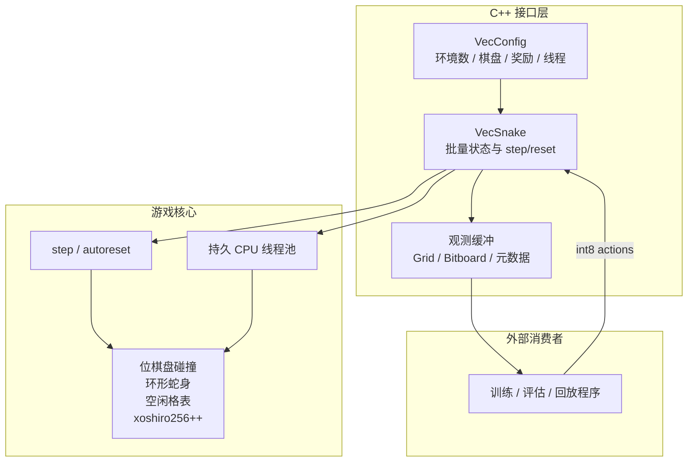
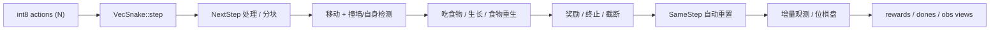

# Snake-DRL C++ 核心最终设计（快照）

## 1. 定位

本工程是贪吃蛇强化学习项目的 **CPU-only C++ 游戏核心**。

- 游戏状态、碰撞、RNG、奖励、终止、观测生成全部在 C++/CPU 完成。
- 不依赖 CUDA、不管理显存、不在热路径做主机-设备同步。
- 不依赖外部训练框架；训练/评估程序是外部消费者。
- 以批量环境为单位运行：一次 `step` 更新 N 个环境。
- 热路径预分配、零堆分配、可复现。
- 单环境就是 `N=1` 的批量环境，没有两套语义。

### 1.1 设计原则

1. **CPU 局部性**：位棋盘、紧凑坐标、SoA、连续环境切片。
2. **复杂度**：移动/碰撞/食物采样期望 O(1)，避免全盘扫描。
3. **批量**：N 个环境共享一次调用和线程池。
4. **零分配**：正常 step 不创建容器、不分配内存。
5. **可复现**：每环境独立 RNG，结果与线程数无关。
6. **核心独立**：核心只暴露 C++ API 与原始观测缓冲。

### 1.2 非目标

- 不在 GPU 上实现游戏逻辑。
- 不实现训练算法、神经网络、环境适配或渲染。
- 不支持超过 64×64 的棋盘。
- 不支持多智能体、联机、障碍物或传送门。
- 单个 `VecSnake` 实例不支持并发调用。

---

## 2. 架构



### 2.1 模块职责

| 模块 | 职责 |
|---|---|
| `include/snake/config.hpp` | `VecConfig`、enums、棋盘常量 |
| `include/snake/cell.hpp` | 公开的打包坐标编解码 |
| `include/snake/span.hpp` | 最小只读 `Span` |
| `include/snake/view.hpp` | `VectorView`/`MatrixView`/`GridView` |
| `include/snake/vec_snake.hpp` | 公共 RAII 门面，隐藏内部实现 |
| `src/detail/engine.hpp` | 批量状态与内部引擎声明 |
| `src/engine.cpp` | 配置校验、分配、种子、生命周期 |
| `src/environment.cpp` | 规则、step、reset、autoreset、观测更新 |
| `src/invariants.cpp` | 完整状态不变量校验 |
| `src/thread_pool.cpp` | 持久线程池实现 |
| `src/detail/bitboard.hpp` | 位棋盘、紧凑索引 |
| `src/detail/free_cells.hpp` | 空闲表与 O(1) 食物采样 |
| `src/detail/grid_observation.hpp` | 增量网格观测视图 |
| `src/detail/rng.hpp` | xoshiro256++ 与 Lemire 采样 |
| `src/detail/thread_pool.hpp` | 线程池接口与并行任务模板 |
| `tests/` | 模块测试与引擎压力测试 |
| `benchmarks/bench_core.cpp` | 纯 C++ 吞吐基准 |

### 2.2 单步执行流程



---

## 3. 游戏规则与 MDP

### 3.1 棋盘

- 网格 `W × H`，默认 16×16，支持 3×3 到 64×64。
- 坐标打包：`cell = (y << 6) | x`，`uint16_t`。
- 初始蛇水平放置在中间行，头朝右，长度默认 3。
- 食物位于空闲格；吃到后从剩余空闲格中均匀随机重生。
- 蛇填满棋盘时胜利。

### 3.2 动作

默认相对动作：

| action | 含义 |
|---:|---|
| 0 | 直行 |
| 1 | 右转 |
| 2 | 左转 |
| 其他 | 直行 |

`relative_actions=false` 时使用绝对方向：`0=上, 1=右, 2=下, 3=左`；反向输入被忽略。

### 3.3 观测

| 模式 | 内容 | 用途 |
|---|---|---|
| `Bitboard` | `rows (N,H) uint64` + head/food | 默认，性能优先 |
| `Grid` | `(N,3,H,W) uint8` | 密集观测/CNN/调试 |
| `NoObs` | 不维护密集观测，只保留位棋盘与元数据 | 诊断/基准 |

Grid 通道：

| 通道 | 内容 |
|---:|---|
| 0 | 蛇身（包含蛇头） |
| 1 | 蛇头 |
| 2 | 食物 |

### 3.4 奖励

| 事件 | 默认奖励 |
|---|---:|
| 吃到食物 | `+1.0` |
| 撞墙/撞自身 | `-1.0` |
| 每步 | `0.0` |
| 填满棋盘 | `+2.0` 额外奖励 |

### 3.5 终止与截断

- `terminated`：死亡或胜利。
- `truncated`：达到 `max_episode_steps`，或连续 `max_steps_without_food` 未进食。
- 两者分别输出，由外部训练代码处理 bootstrap。

### 3.6 自动重置

| 模式 | 语义 |
|---|---|
| **SameStep** | 终止步内完成 reset；`obs` 已是新 episode；旧状态在 `final_*` |
| NextStep | 终止步返回终局；下一次 step 才 reset；reset 步 reward=0、动作忽略 |
| Disabled | 不自动 reset；调用者用 mask 手动重置。未重置前重复 `step` 是 no-op：reward/returns/done/terminated/won 保持终止步的值，不会丢失终局信号 |

默认 `SameStep`：每个 step 都是有效 transition。

---

## 4. 数据结构

### 4.1 SoA 布局

所有环境的同类数据放在连续数组中，按环境切片。`C = W*H`。

| 数组 | 类型 | 说明 |
|---|---|---|
| `rows` | `uint64_t[N*H]` | 每行位掩码 |
| `body` | `uint16_t[N*C]` | 蛇身环形缓冲区 |
| `free` | `uint16_t[N*C]` | 空闲格列表 |
| `free_pos` | `uint16_t[N*C]` | 紧凑格 → 空闲列表下标 |
| `head/food` | `uint16_t[N]` | 打包坐标 |
| `head_idx/tail_idx` | `uint16_t[N]` | 环形缓冲区下标 |
| `len/score/steps` | `int32_t[N]` | 长度、得分、步数 |
| `steps_no_food` | `int32_t[N]` | 连续未进食步数 |
| `free_count` | `int32_t[N]` | 空闲格数量 |
| `dir/flags` | `uint8_t[N]` | 方向与状态标志 |
| `rng` | `Xoshiro256[N]` | 每环境独立随机流 |
| `rewards/returns` | `float[N]` | 单步奖励与累计回报 |
| `final_returns` | `float[N]` | 终止步的累计回报 |
| `obs` | `uint8_t[N*3*C]` | 仅 Grid |
| `final_obs` | `uint8_t[N*3*C]` | 仅 SameStep + Grid |
| `final_rows` | `uint64_t[N*H]` | 仅 SameStep + Bitboard |

SoA 的原因：

- 批量顺序访问缓存行利用率高；
- 线程池按连续区间分块，各线程写不同切片；
- 避免每环境独立容器带来的随机堆访问。

### 4.2 位棋盘

- 每环境 `uint64_t rows[H]`。
- 第 `y` 行第 `x` 位存储位置为 `x ^ 7`，使字节展开后与 big-endian unpack 顺序一致。
- 碰撞：`(rows[ny] & mask(nx)) != 0`。
- 更新：`rows[y] |= mask(x)` / `rows[y] &= ~mask(x)`。

复杂度 O(1)，无哈希、无每步分配。

### 4.3 蛇身环形缓冲区

- 长度 C 的环，`tail_idx` 指向尾，`head_idx` 指向头。
- 前进：推进头并写入新头。
- 不生长：同时推进尾，释放旧尾格。
- 生长：只推进头。
- 允许进入“当前尾格”，因为尾格会在同一步释放。

避免 `std::deque` 的块分配和 `vector::erase(begin())` 的 O(L) 搬移。

### 4.4 空闲格表

- `free[]` 保存所有空闲格打包坐标。
- `free_pos[compact(cell)]` 保存其在 `free[]` 中的下标。
- `compact(cell) = (cell>>6)*W + (cell&63)`。
- 删除用 swap-remove，插入直接追加。
- 食物采样：`[0, free_count)` 随机下标，swap-remove 后作为食物。

期望 O(1)，严格均匀。

### 4.5 随机数

- 每环境独立 `xoshiro256++`。
- 环境 `i` 的种子为 `base_seed + i`。
- 区间采样使用 Lemire multiply-shift + rejection，期望少于 2 次迭代。
- 无全局锁；并行调度不改变结果。

### 4.6 增量网格观测

Grid 模式只更新变化格：

- 普通移动：清旧尾 body、写新头 body、清旧头 head、写新头 head。
- 生长：不清尾。
- 进入当前尾格：body 不变，只移动 head 通道。
- 吃食物：清旧食物格，写新食物格。
- 重置：清旧蛇身/头/食物，写新状态。
- 死亡：状态与观测不变。

正常 step 只写常数个格子，而不是 `3C` 字节。

### 4.7 增量重置

1. 旧蛇身与旧食物归还空闲表。
2. 清空位棋盘（H 个字）。
3. 清旧观测格。
4. 放置新蛇（从空闲表移除 L_new 格）。
5. 采样新食物。

典型 `O(L_old + L_new)`，满盘胜利时最坏 O(C)。

### 4.8 复杂度

| 操作 | 复杂度 | 说明 |
|---|---|---|
| 移动/碰撞 | 期望 O(1) | 位棋盘 + 环形缓冲 |
| 吃食物/食物重生 | 期望 O(1) | 空闲表 swap-remove |
| 增量 Grid 观测 | 期望 O(1) | 只写变化格 |
| Bitboard step | 期望 O(1) | 不生成网格 |
| reset | 典型 O(L_old + L_new) | 最坏 O(C) |
| 构造 | O(N·C) | 一次性建立空闲表 |
| 批量 step | 期望 O(N) | 线程池并行 |
| 内存 | O(N·(C+H)) | 见 §5.5 |

---

## 5. CPU 执行模型

### 5.1 为什么在 CPU

贪吃蛇单步只有少量标量指令，但分支密集（撞墙、进食、进入尾格、重置）。GPU 的 kernel launch、同步和传输成本远高于计算。CPU 的单核性能、缓存和位运算更适合该 workload。

### 5.2 持久线程池

- `VecSnake` 构造时创建线程池，生命周期内复用。
- 调用线程处理第 0 块；工作线程处理其余连续环境切片。
- 每次 step 只做一次原子发布/等待，不创建线程。
- 空闲等待采用自适应策略：
  1. 短暂自旋（`cpu_relax`）；
  2. 自旋结束后 `std::this_thread::yield()`；
  3. 继续空闲则每 50 µs 休眠一次，直到下一次任务。
- 该策略兼顾连续训练的低延迟与 CPU 占用，避免长时间空转。

### 5.3 线程数

| `num_threads` | 含义 |
|---:|---|
| `0` | 自动：`max(1, min(hardware_threads - 1, 5))` |
| `1` | 强制串行 |
| `>1` | 显式总线程数（包含调用线程） |

- 自动模式给调用方/OS 留一个核。
- `parallel_threshold=128`：N < 128 串行，避免调度开销。
- 多个 `VecSnake` 实例会各自建池；共享 CPU 时显式降低线程数。
- 显式把 `num_threads` 设到接近或超过硬件线程数时，超订可能反而变慢；
  auto 的 5 线程上限是刻意的。基准输出会打印实际线程数，便于对照。

### 5.4 热路径优化

- `step` 内不 `new`/`malloc`、不构造容器、不抛异常、不格式化字符串、不调用虚函数。
- 观测增量写入；食物采样只操作预分配空闲表。
- 坐标/蛇身/空闲表使用 `uint16_t`。
- 位棋盘只访问头/尾所在行。
- Grid 观测按环境连续存放，通道平面布局 `(N,3,H,W)`。
- Bitboard 模式不写观测缓冲，适合大棋盘。
- 线程池静态连续分块，减少伪共享。

### 5.5 内存模型

| 模式 | 每环境内存 |
|---|---|
| Bitboard | `8H + 6C + 32 + ~64` 字节；SameStep 额外 `8H + 8` 字节 |
| Grid | `8H + 6C + 3C + 32 + ~64` 字节；SameStep 额外 `3C + 8H + 8` 字节 |
| NoObs | `8H + 6C + 32 + ~64` 字节；SameStep 额外 `8H + 8` 字节 |

（另含 `final_returns` 的 4 字节/环境。）

`C = W*H`；Bitboard 的 `6C` 为 `body + free + free_pos`。内存只随 N、C 线性增长，不随 episode 长度增长。

### 5.6 性能验证

具体数值由目标机器基准确定，不固化在设计中。`benchmarks/bench_core.cpp` 覆盖：

1. 纯 C++ 微基准：只计时 `step` 的 `ns/env-step`，3 次取中位数；
2. 模式对比：Bitboard / Grid / NoObs；
3. 线程扩展：N=4096、16×16、1/2/4/8 线程；
4. 规模：16×16 的 N ∈ {256,1024,4096}，64×64 的 N ∈ {256,1024}；
5. 所有模式/线程行共用同一动作流，便于横向比较；
6. 输出实际线程数；Debug 构建会显式警告数字不可用。

不包含固定 CPU 亲和性、长蛇脚本或高 done 率专项；这些需要目标机器上的单独测量。

---

## 6. 观测接口

### 6.1 Bitboard（默认）

- `rows`（`BoardView`）：`(N,H) uint64`，每行位掩码。
- `head`: `(N,) uint16`，打包坐标；无效 `0xFFFF`。
- `food`: `(N,) uint16`，打包坐标；无效 `0xFFFF`。
- 打包坐标的公开编解码在 `snake/cell.hpp`：`pack_cell/cell_x/cell_y`。
- 不分配 `obs`/`final_obs`；SameStep 分配 `final_rows`、`final_head`、`final_food`。
- 位布局 `x ^ 7`，兼容 big-endian byte unpack。

### 6.2 Grid（可选）

- `obs`（`GridView`）：形状 `(N,3,H,W)`，`uint8`。
- 通道 body、head、food。
- 增量维护，不每步重建。
- 适合密集观测/CNN/调试。

### 6.3 视图契约

- 所有访问器返回 `Span` / `VectorView` / `MatrixView` / `GridView`，均是非拥有、只读、可平凡复制的视图。
- 形状自描述：`VectorView::size()`、`MatrixView::rows()/cols()`、`GridView::num_envs()/channels()/height()/width()`。
- 不支持的模式或未分配的缓冲返回空视图（`valid() == false`、`size() == 0`、`data() == nullptr`），调用方无需猜测 `nullptr` 的含义。
- `operator[]` / `at()` 在 Debug 下做边界断言；热路径可先用 `data()` 取裸指针。
- 视图指向内部缓冲，`step/reset` 原地更新，上一 step 的内容不可跨 step 保存。
- 需要历史数据时立即复制。
- `final_*` 只在对应环境最近一次 `dones == 1` 时有意义；手动 reset 后不应读取旧终局数据。
- 不要修改核心返回的观测缓冲；增量更新假设缓冲与内部状态一致（视图本身是只读的）。

---

## 7. C++ API

### 7.1 基本用法

```cpp
#include <cstdint>
#include <vector>

#include "snake/vec_snake.hpp"

snake::VecConfig cfg;
cfg.num_envs = 1024;
cfg.width = 16;
cfg.height = 16;
cfg.obs_mode = snake::ObsMode::Bitboard;
cfg.autoreset_mode = snake::AutoresetMode::SameStep;
cfg.num_threads = 0;

snake::VecSnake env(cfg);
env.reset_all();

std::vector<int8_t> actions(cfg.num_envs, 0);
env.step(actions.data());

snake::BoardView rows = env.bitboards();        // (N,H)
snake::CellView head = env.head_cells();        // (N,)
snake::CellView food = env.food_cells();
snake::FloatView rewards = env.rewards();
snake::ByteView dones = env.dones();

const std::uint64_t row0 = rows.at(0, 0);
const std::uint16_t head0 = head[0];
```

Grid 模式：

```cpp
cfg.obs_mode = snake::ObsMode::Grid;
snake::VecSnake env(cfg);
env.reset_all();
snake::GridView obs = env.observations();  // (N,3,H,W)
const std::uint8_t cell = obs.at(0, 0, 3, 7);  // env, channel, y, x
```

### 7.2 状态访问

| 方法 | 内容 |
|---|---|
| `bitboards()` | `BoardView`，`(N,H) uint64` |
| `head_cells()` / `food_cells()` | `CellView`，`(N,) uint16` |
| `observations()` | `GridView`，`(N,3,H,W) uint8`（Grid） |
| `rewards()` / `returns()` / `final_returns()` | `FloatView`，`(N,) float` |
| `directions()` | `ByteView`，`(N,) uint8`，0=上,1=右,2=下,3=左 |
| `dones()` / `terminated()` / `truncated()` / `wins()` / `needs_reset()` | `ByteView`，`(N,) uint8` |
| `scores()` / `lengths()` / `steps()` / `final_scores()` / `final_lengths()` | `Int32View`，`(N,) int32` |
| `reseed_all(seed)` | 用 `seed+i` 重建所有环境，等价于同种子的新建实例，幂等 |
| `reseed_env(i, seed)` | 用 `seed` 重建环境 i；其余环境不变 |
| `final_*()` | SameStep 终局数据（obs 需 Grid；bitboard/head/food 仅 SameStep；score/length/return 始终有效） |
| `check_invariants(i)` | 测试/调试不变量（会分配临时内存） |

### 7.3 配置默认值

| 字段 | 默认 |
|---|---|
| `num_envs` | 64 |
| `width/height` | 16/16 |
| `initial_length` | 3 |
| `max_episode_steps` | 2000 |
| `max_steps_without_food` | 0（关闭） |
| `food_reward` | 1.0 |
| `death_penalty` | -1.0 |
| `step_penalty` | 0.0 |
| `win_bonus` | 2.0 |
| `relative_actions` | true |
| `autoreset_mode` | SameStep |
| `obs_mode` | Bitboard |
| `num_threads` | 0（auto） |
| `parallel_threshold` | 128 |

### 7.4 生命周期与线程安全

- 一个 `VecSnake` 实例只能被一个线程同时调用 `step/reset`。
- 内部线程池只服务该实例。
- 析构时停止并 join 工作线程。
- 多实例并行时各自独立，不受彼此状态影响。

---

## 8. 构建、测试与基准

### 8.1 构建

依赖：

- C++17
- CMake ≥ 3.20
- 线程库（CMake `Threads::Threads`，GCC/Clang 下为 pthread）

```bash
cmake --preset release
cmake --build --preset release
```

也可以直接使用：

```bash
cmake -S . -B build -DCMAKE_BUILD_TYPE=Release
cmake --build build -j
```

安装后消费者使用 `find_package(snake_core CONFIG REQUIRED)` 和
`snake::snake_core` 目标。

选项：

```text
-DSNAKE_BUILD_TESTS=ON|OFF
-DSNAKE_BUILD_BENCHMARKS=ON|OFF
-DSNAKE_ENABLE_IPO=ON|OFF
-DSNAKE_ENABLE_INSTALL=ON|OFF
-DSNAKE_STRICT_WARNINGS=ON|OFF      (默认 ON)
-DSNAKE_WARNINGS_AS_ERRORS=ON|OFF
```

### 8.2 测试

```bash
ctest --test-dir build --output-on-failure
# 或
./build/snake_core_tests
```

覆盖：

- 随机动作长时间压力；
- 空闲表、蛇身唯一性、食物位置、位棋盘、观测通道不变量；
- 非方形/极端棋盘（3×3、10×7、3×64、64×3）；
- 串行 vs 并行确定性；
- reset mask、步数截断、绝对动作、反向忽略；
- SameStep / NextStep / Disabled；
- 撞墙、死亡、自动重置、终局状态；
- 胜利路径与终局观测、终局分数/长度。

### 8.3 基准

```bash
./build/snake_benchmark
./build/snake_benchmark --quick
```

基准覆盖 Bitboard/Grid/NoObs、串行/自动线程、不同 N 与棋盘尺寸。具体数值以目标机器为准。

### 8.4 健壮性

- 推荐使用 UBSan 构建运行测试。
- 线程池析构时停止并 join。
- 单实例不支持并发 `step`。

---

## 9. 约束与扩展点

### 9.1 固定约束

- 最大 64×64（单字行掩码）。
- 单食物、无传送门、无障碍物。
- 初始蛇固定在中间行，头朝右。
- 单实例不支持并发调用。
- 自动线程数有保守上限，可显式覆盖。

### 9.2 扩展点

- 更大棋盘：每行多字位掩码。
- 随机初始位置/方向：扩展初始放置。
- 多食物/障碍物：扩展空闲表与观测通道。
- 特征观测：增加低维观测模式。
- 动态分块：平衡长蛇/异构策略的线程负载。
- 线程亲和性/对齐分配：按基准决定。

---

## 10. 验收标准

1. **复杂度**：Bitboard 正常 step 期望 O(1)；Grid 增量观测 O(1)；reset 典型 O(L)。
2. **分配**：正常 `step` 无堆分配；构造后缓冲固定。
3. **确定性**：相同种子和动作序列，串行/并行结果一致。
4. **批量**：N 个环境一次调用；N=1 与单环境语义一致。
5. **零拷贝**：观测/状态视图指向内部缓冲，不产生每步复制。
6. **内存**：O(N·(C+H))，与 episode 长度无关；`free_pos` 按 C 分配。
7. **CPU 占用**：线程池空闲自适应退避；自动线程给调用方留核。
8. **正确性**：C++ 不变量压力测试全通过。
9. **构建**：纯 C++ 工程，无外部运行时、无 CUDA 依赖。
10. **性能**：在目标机器上用 `snake_benchmark` 复现，瓶颈不落在锁、分配或观测重建上。
